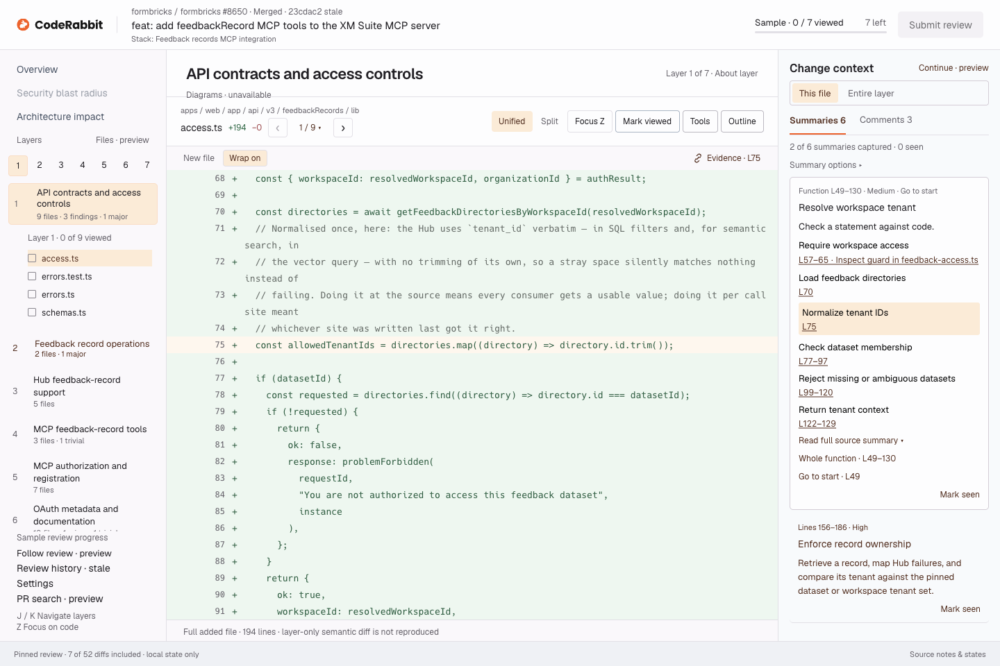

# CodeRabbit Change Stack Review

Independent design exercise by Parth Pawar. The primary submission redesigns one reviewing screen using the assigned Formbricks #8650 review run, commit `23cdac2`.

- [Editable Paper design and process](https://app.paper.design/file/01M5AQACJZP42ZGTRX7GF9ERE7/p-1-0/1YS-0)
- [Public working prototype](https://parthawe.github.io/coderabbit-change-stack-review/)
- [One-page rationale](https://parthawe.github.io/coderabbit-change-stack-review/rationale.pdf)
- [Original and redesign](https://parthawe.github.io/coderabbit-change-stack-review/comparison.html)
- [Requirement audit](docs/REQUIREMENT-AUDIT.md)
- [Verification and limits](docs/verification.md)

## Review order

Start in Paper at board 00. Board 01 records the original screen and four diagnoses; board 02 is the editable main design; board 03 maps interactions and retained capabilities. Boards 04–06 cover focus, review decisions, and source failure. Then use the browser prototype to try the same flow. Paper's exported structure and computed styles provided implementation references; static HTML, CSS, and JavaScript add interaction state.

Paper is set to anyone with the link, but signed-out reviewers currently encounter sign-in. The public prototype provides login-free access. The challenge accepts a viewable prototype plus a one-page explanation; Paper is the additional editable design deliverable.

## Try it

Choose a summary to reveal its exact code range. Mark the summary seen and the file viewed separately. J moves to the next layer; K moves back. Z hides surrounding panels and preserves scroll position. The file-position control opens nine verified file paths, seven with complete added-file diffs. Comments begin with resolved messages hidden; Show resolved reveals the captured historical thread. Submit review opens a simulated decision dialog. No review or message is sent.

Source notes expose loading, observed rate-limit, no-comments, and reset demonstrations. Shortcuts ignore typing. State stays in tab memory and resets on reload.

## Evidence coverage

The exact assigned link initially loaded without sign-in. Later layer loads and reloads became rate limited. Captured evidence verifies all seven layer names and counts (52 files total), the first layer's nine file paths, 37 layer summaries, and 15 resolved comment messages. Fourteen summary ranges are reproduced in condensed wording. One resolved access-control root thread is paraphrased; its two reply bodies are not reproduced.

Seven added files use complete source retrieved from the exact pinned GitHub commit. The other two layer-1 files are modified files whose patches were not captured. Their diffs, the other six layers' detailed content, and uncaptured summaries are labeled coverage limits. A stale snapshot and resolved finding do not establish a current defect.

The main workspace and all four product approaches now use the same Formbricks PR and access.ts. Each has a rationale answering the judging criteria. The four inspection views show identical lines 178–183; proposed scenarios and synthetic author input remain labeled. The [comparison gallery](https://parthawe.github.io/coderabbit-change-stack-review/approaches.html) mirrors Paper. Earlier mono screenshot work remains archived.

## Run locally

Requires Python 3; no package install or build step.

```sh
python3 -m http.server 4317 --directory dist
```

Open `http://localhost:4317`. Use HTTP because the prototype fetches `review-data.json`.

## Files and attribution

`dist/` contains the runnable site, pinned fixture, rationale, and comparison. `design/paper-submission/` contains native Paper PNG exports, raw composition references, computed values, and a manifest. Raw `.paper-export.txt` files are design references, not runnable React components. `design/evidence/` records source evidence. `docs/` explains design decisions, scope, and checks.

The visual system follows CodeRabbit's [official brand guidelines](https://www.coderabbit.ai/brand): intact approved logo, orange/mauve palette, Geist, and Hack. Font licenses are included. Formbricks source is attributed to Formbricks at the pinned commit; its license is retained in `dist/FORMBRICKS-LICENSE.txt`. Public repository access does not grant a separate license to CodeRabbit branding or assignment reference material.


