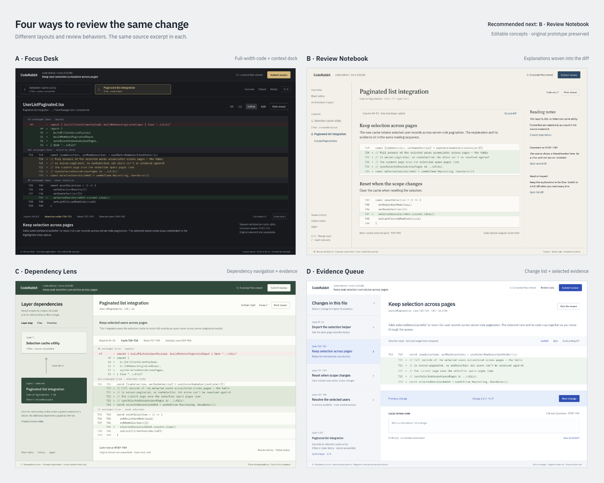

# CodeRabbit Change Stack Review

Independent design assignment by Parth Pawar. This repository contains the working browser prototype, four visual explorations, Paper design references, and a separate comparison of product approaches.

- [Working prototype](https://coderabbit-review-parth.pawar-d-parth.chatgpt.site/)
- [Product approach alternatives](docs/approaches.md)
- [Visual exploration gallery](https://coderabbit-review-parth.pawar-d-parth.chatgpt.site/directions)
- [Editable baseline in Paper](https://app.paper.design/file/01M5AQACJZP42ZGTRX7GF9ERE7/p-1-0)
- [Editable visual explorations in Paper](https://app.paper.design/file/01M5AQACJZP42ZGTRX7GF9ERE7/p-2-0)
- [One-page rationale](dist/rationale.pdf)

## Run locally

Requires Python 3. From the repository root:

```sh
python3 -m http.server 4317 --directory dist
```

Open http://localhost:4317. The prototype loads its excerpt from JSON, so use an HTTP server. No package installation or build step is required.

## Try the prototype

Select a layer, choose a summary to reveal its code, and toggle file progress with Mark viewed. J/K changes layers; Z toggles focus mode while preserving position. Shortcuts ignore typing. Submit review opens a decision dialog and ends with a simulated confirmation. Comments support a local draft. All review state stays in tab memory and resets on reload.

The Source notes & states control demonstrates loading, unavailable, and no-comments states. Direct previews also work at `?state=loading`, `?state=unavailable`, and `?state=empty`. Secondary tools open labeled previews.

## Scope and source

The assignment screenshots show coderabbitai/mono #22041 with two layers and three files. The supplied live link points to a different Formbricks PR and was rate limited during inspection. The prototype uses one visible UserListPaginated.tsx excerpt from the supplied screenshots. Missing files, hidden code, and original comment text are labeled as unavailable. Summary wording is condensed; line wrapping is normalized.

The four gallery screens are editable design explorations. Their depicted controls are proposed interactions. The product approaches in `docs/approaches.md` are conceptual alternatives and have not been implemented. The working prototype is the baseline three-region review workspace.

This is an independent exercise. Review submission sends nothing to CodeRabbit or GitHub. No analytics or backend integration is included. The reference screenshot is included as assignment comparison material.

## Repository contents

| Path | Contents |
| --- | --- |
| `dist/` | Buildless HTML, CSS, JavaScript, excerpt JSON, fonts, rationale, comparison view, and four-direction gallery |
| `docs/approaches.md` | Alternatives for how the product helps someone reach a review decision |
| `docs/DESIGN.md` | Baseline design values and behavior |
| `docs/verification.md` | Recorded browser checks and known limits |
| `design/` | Exported Paper styles, raw composition references, and visual concept metadata |

Raw `*.paper-export.txt` files preserve Paper output for reference. They contain source-code text that is not escaped for JSX and are not runnable React components. Edit the Paper files or use the working source in `dist/`.

## Validation and reuse

The baseline was checked at 1440, 1280, and 1100 px, including keyboard navigation, focus restoration, summary highlights, progress, split diff, and simulated submission. The gallery was checked for image loading, filtering, enlarged views, Escape, focus restoration, and a narrow layout. See the verification record for details and limitations.

IBM Plex fonts are self-hosted under the SIL Open Font License in `dist/fonts/OFL.txt`. Public repository visibility does not grant a separate license to CodeRabbit branding, assignment reference material, or third-party source excerpts.


